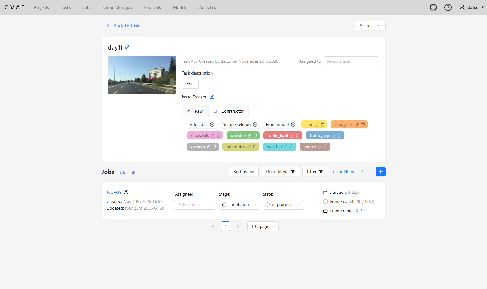
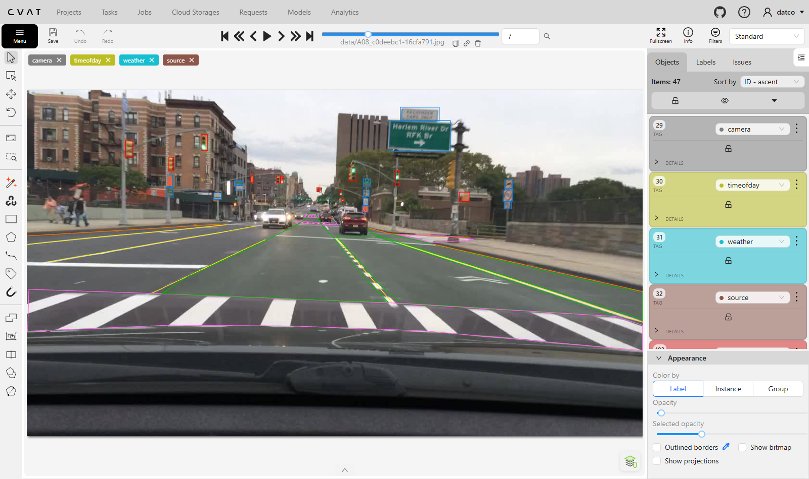
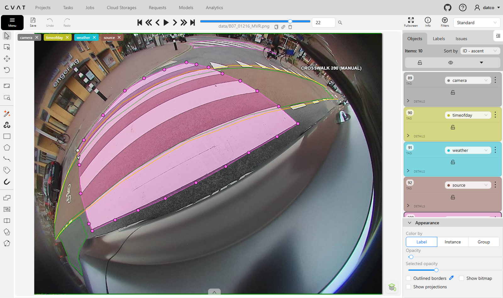
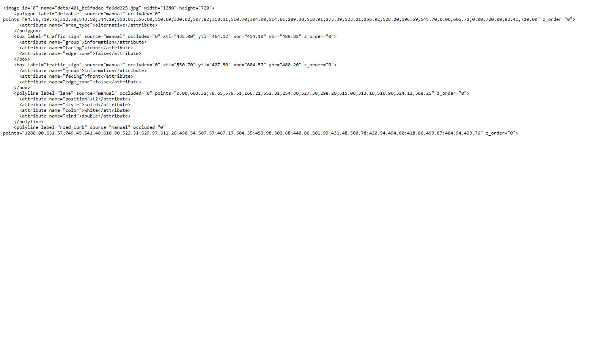

# Báo cáo cá nhân — Ngày 11

Họ tên: Bùi Công Đạt      Mã học viên: 2A202603068
Phiên bản CVAT (Help → About): 2.82.0
Guideline: Road v1.0    Lần nộp (`revision` trong manifest): 1
Thời điểm export (ngày giờ trên CVAT): 2026-11-22 21:39:46    Số lần nộp lại sau Rework: 0

## 1. Kiểm project

| Mục | Đúng như guideline Road v1.0? | Ghi chú |
| --- | --- | --- |
| 6 label, đúng kiểu | Đúng | `lane`, `road_curb` là polyline; `crosswalk`, `drivable` là polygon; `traffic_light`, `traffic_sign` là rectangle |
| Thuộc tính và giá trị | Đúng | Dán tab Project → Labels → Raw bằng JSON sinh từ `python -m road_lab.taxonomy`, đối chiếu với `configs/road_v1_labels.json` |
| 4 tag ảnh | Đúng | Bốn label Tag: `camera`, `timeofday`, `weather`, `source`; mỗi label có một thuộc tính select tên `value` |

Cách kết thúc polyline trên bản CVAT này: bấm phím **N** sau điểm cuối.
Cách đặt tag ảnh trên bản CVAT này: công cụ **Tag** ở thanh bên trái, đặt `camera` trước rồi `timeofday`, `weather`, `source`; mở **Details** trong bảng Objects để kiểm giá trị.

## 2. Số lượng đã gán

| Task | Ảnh | lane | road_curb | crosswalk | drivable | traffic_light | traffic_sign |
| --- | ---: | ---: | ---: | ---: | ---: | ---: | ---: |
| front | 12 | 40 | 17 | 10 | 29 | 42 | 40 |
| front-extra (đã làm 4 / 4) | 4 | 13 | 6 | 4 | 9 | 7 | 16 |
| fisheye | 8 | 7 | 11 | 10 | 12 | 9 | 7 |
| fisheye-extra (đã làm 4 / 4) | 4 | 0 | 5 | 5 | 7 | 0 | 0 |

Tổng: 28 ảnh, 297 shape và 112 tag. Số ảnh đủ bốn tag: 28/28 (manifest ghi `images_all_tags` 16 và 12).

## 3. Bảng ca khó

| Ảnh | Nhãn | Phân vân giữa | Đã chọn | Lý do |
| --- | --- | --- | --- | --- |
| A05 | lane | vẽ bổ sung L1/R1 / để trống | Để trống | Ảnh chỉ có lề và mép đường, không thấy vệt sơn ở hai bên làn đang đi; vẽ thêm sẽ là nhãn thừa. Lint báo QC1-02, đây là ca miễn theo guideline mục 5 và delivery mục 2 |
| A06 | lane | vẽ R1 / để trống | Để trống | Làn phải sát hàng xe đỗ, không có vạch sơn nhìn thấy được |
| A07 | lane | vẽ L1 / để trống | Để trống | Bên trái là dải phân cách, không có vạch kẻ |
| A09 | lane | vẽ R1 / để trống | Để trống | Mép phải là lề đất, không sơn |
| A14 | lane | vẽ R1 / để trống | Để trống | Ảnh thêm; bên phải là vỉa hè, không có vạch |
| A15 | lane | vẽ R1 / để trống | Để trống | Ảnh thêm; bên phải bị che gần hết, không đủ căn cứ vẽ |
| A01 | lane L2 | một polyline / hai polyline | Hai polyline | Ảnh có vạch đôi: mỗi nét song song là một vạch riêng, cùng `position = L2`. Lint báo QC1-05 "2 polyline cùng position", nhưng đây không phải vạch đứt bị tách |
| A04, A06, A09, A11, A12, A14, A15 | lane | một polyline / hai polyline | Hai polyline | Cùng lý do A01: vạch đôi hoặc hai vạch khác loại nằm cùng phía. Cần coach xác nhận nếu chấm là QC1-05 |
| B05, B07, B08 | lane | L1/R1 / other | `position = other` | Camera fisheye bên trái và bên phải: guideline mục 4 buộc dùng `other`, không dùng L1/R1/L2/R2 |
| B04 | traffic_light | bật / tắt `edge_zone` | Tắt | Tâm box nằm trong 80 % bán kính; lint chỉ gợi ý tự kiểm, không phải lỗi chấm |

## 4. Phiếu QC 1 nhận được

Bạn kiểm lô của tôi:  chuviethung (chưa gửi phiếu)    Quyết định nhận được:  chưa có

| Mã lỗi | Số lỗi | Đồng ý? | Đã sửa? |
| --- | ---: | --- | --- |
| QC1-02 đủ L1, R1 | 7 | Đồng ý một phần: A05, A06, A07, A09, A14, A15 thật sự không có vạch ở một bên, thuộc ca miễn. A03 đã có R1 sau khi rà lại | Không sửa: vẽ thêm sẽ tạo nhãn thừa |
| QC1-03 position | 5 | Đồng ý, lỗi thật | Đã sửa trước khi nộp: B05, B07, B08 đổi mọi lane sang `position = other` |
| QC1-05 vạch đứt bị tách | 10 | Không đồng ý: A01, A04, A06, A09, A11, A12, A14, A15 là vạch đôi, hai nét là hai vạch riêng cùng `position` | Không sửa; đã ghi vào bảng ca khó mục 3 |
| QC1-11 fisheye (gợi ý `edge_zone`) | 1 | Không đồng ý: tâm box B04 nằm trong 80 % bán kính | Không sửa |
| QC1-12 điểm lặp | 5 | Đồng ý, lỗi thật | Đã sửa trước khi nộp: xoá mọi cặp điểm trùng liền nhau |

Bảng trên là kết quả **tự kiểm lô của mình** bằng `road_check lint` và đối chiếu ảnh gốc, không phải phiếu nhận từ chuviethung. Hai bên đổi lô trong Task 3; phiếu của chuviethung chưa về tại thời điểm nộp. Khi phiếu về, bảng này được đối chiếu lại: cột "Đồng ý?" sẽ ghi theo nhận xét của chuviethung, cột "Đã sửa?" ghi theo buffer.

## 5. Kiểm file export

| File | Mở lại được? | Số shape ảnh 1 (job / file) | Số shape ảnh 2 (job / file) | Tag camera có trong XML? |
| --- | --- | --- | --- | --- |
| `buicongdat-front.zip` | Có, `road_check lint` đọc được 16 ảnh | A01: 12 shape + 4 tag | A02: 8 shape + 4 tag | Có, `<tag label="camera">` với `<attribute name="value">front</attribute>` |
| `buicongdat-fisheye.zip` | Có, `road_check lint` đọc được 12 ảnh | B01: 7 shape + 4 tag | B02: 10 shape + 4 tag | Có, `value = fisheye_front` |

Kiểm tự động: `contains_images` là `false` ở cả hai file (manifest). Số ảnh 16 và 12, khớp số ảnh đã gán. Không có ảnh nào chưa gán (`images_unlabelled` 0).

## 6. Ảnh chụp màn hình

Bốn ảnh chụp trực tiếp trên CVAT của lớp (`http://localhost:8080`), đăng nhập bằng tài khoản `datco`, chụp ngày 23/11/2026.

1. Task `day11` (#67): đủ 6 label vẽ (`lane`, `road_curb`, `crosswalk`, `drivable`, `traffic_light`, `traffic_sign`) và 4 label Tag (`camera`, `timeofday`, `weather`, `source`), kèm Job #59 với 28 frame:

2. Job #59 frame 7 (A08), ảnh camera trước đã gán đủ: lane, road_curb, crosswalk, drivable, box đèn và biển, 4 tag trên thanh trên cùng, bảng Objects 47 mục:

3. Job #59 frame 22 (B07), camera fisheye đã phóng to: polyline làn đi theo cung, polygon `crosswalk` bám cả vùng ngựa vạn:

4. Đoạn `annotations.xml` của A01, thấy rõ `<polyline label="lane">` với đủ bốn thuộc tính `position`, `style`, `color`, `kind`:

Phụ lục (không bắt buộc): bốn hình dựng từ `annotations.xml`, dùng khi cần đối chiếu nhanh nhãn với ảnh gốc:

- [Bảng label sinh từ taxonomy](figures/fig1-labels.png)
- [A08 với nhãn vẽ chồng](figures/fig2-front-A08.png)
- [B07 với khung phóng to polyline cong](figures/fig3-fisheye-B07.png)
- [Đoạn XML dạng ảnh](figures/fig4-xml.png)

## 7. Tự đánh giá

Lỗi bạn mắc nhiều nhất hôm nay (theo mã QC1-xx), và cách tránh ở Ngày 20: hai lỗi lặp lại nhiều nhất là QC1-02 (thiếu L1/R1 ở ảnh không có vạch sơn) và QC1-05 (vạch đôi vẽ thành hai polyline nên lint hiểu là vạch đứt bị tách). Cách tránh: trước khi vẽ, xác định làn đang đi bằng vạch sát xe chứ không đếm tổng số làn; với vạch đôi thì ghi rõ trong bảng ca khó rằng hai nét là hai vạch, và dùng `kind = double` thay vì vẽ hai polyline cùng `position`.

Nhãn của bạn đi vào model ở đâu? Chọn một lỗi đã sửa và nói nó làm model học sai thế nào: lỗi QC1-03 ở B05/B07/B08 là ví dụ rõ nhất. Camera hai bên phải luôn là `position = other`; nếu để L1/R1, model row-anchor học nhầm rằng vạch sát thân xe ở camera bên là làn đang đi của chính xe. Khi chạy LKA, model sẽ bám sang vạch của làn bên cạnh, tức lệch sang trái hoặc phải đúng một làn.

## 8. (Tùy chọn, buffer) Từ polyline đến đích row-anchor

| y | 720 | 680 | 640 | 600 | 560 |
| --- | ---: | ---: | ---: | ---: | ---: |
| x của chúng tôi (A01, R1) | không có làn | 651.2 | 596.4 | 541.7 | 486.9 |
| x của bạn kia (A01, R1) | không có làn | 651.2 | 596.4 | 541.7 | 486.9 |
| lệch (px) | — | 0.0 | 0.0 | 0.0 | 0.0 |

Số của chuviethung lấy từ `python -m road_lab.rowanchor chuviethung-front.zip --image A01 --position R1 --rows 720,680,640,600,560`, polyline `lane#8@(705,719)`. Hai bên trùng khớp từng hàng, vì cùng một ảnh A01 và vạch R1 nằm ở cùng vị trí; lệch 0 px.

Hàng 720 ghi "không có làn" vì polyline R1 của A01 bắt đầu ở (704.90, 719.23); tại đúng hàng 720 không có đoạn nào cắt qua theo nội suy của `road_lab.rowanchor`.

Trả lời 3 câu:

1. Năm số x đó chính là đích mà một model row-anchor học cho vạch này. Nếu dừng polyline sớm 40 px, tức bỏ đoạn cuối và dừng ở khoảng y = 600 thay vì 560, thì hàng 560 thành "không có làn"; hàng 600 vẫn có nhưng sát đầu polyline nên kém ổn định. Model mất đích ở đúng hàng xa, nên chỉ bám được đoạn gần xe.
2. Ở hàng 720 cả hai đều "không có làn". Ở hàng 680, 640, 600, 560 hai bên lệch 0.0 px vì vạch R1 trùng nhau. Lệch ở hàng sát xe (680) làm xe lệch ngang ngay lập tức; lệch ở hàng xa (560) làm model tính sai độ cong nên ảnh hưởng dự báo hướng đi nhiều hơn. Với bài này cả hai hàng bằng nhau nên không bên nào tạo sai lệch.
3. Nếu vẽ từ xa về gần thì thứ tự điểm đảo. Phép nội suy theo hàng vẫn cho cùng cặp (x, y), nhưng mọi kiểm tra giả định điểm đầu là điểm gần xe sẽ sai: `road_check lint` báo "vẽ từ xa về gần" (QC1-04), còn `road_lab.rowanchor` và model row-anchor lấy điểm đầu để xác định hướng polyline, nên kết quả đọc sai chiều.

<điền nếu làm hoạt động buffer; mục này không tính điểm>

---

Ghi chú công cụ: phần chữ, bảng số liệu và hình trong báo cáo này được soạn với hỗ trợ của AI (trợ lý DeepSeek trong DeepSeek Harness). Toàn bộ số liệu lấy từ chính `annotations.xml` của bài nộp và từ ảnh gốc trong `data/`; không có số nào được nhập tay. Quy tắc gán nhãn và quyết định QC 1 vẫn theo guideline Road v1.0.

